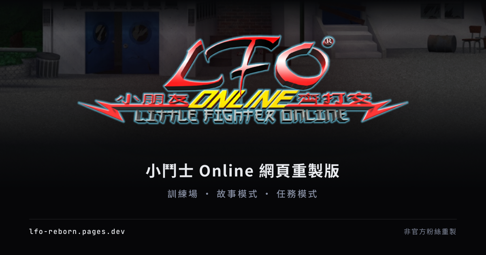

# LFO Reborn — 小鬥士 Online 網頁重製版



《小朋友齊打交 Online》(Little Fighter Online) 嘅非官方粉絲重製。由原版客戶端拆出美術、招式同關卡資料，
砌返一個真係玩得嘅網頁版：選角色、訓練場、故事模式、任務、VS 同連線對戰，全部照原作嘅 frame data 行。

- **線上玩**：<https://lfo-reborn.pages.dev>
- **圖鑑館**（舊博物館）：<https://lfostory.pages.dev/site/lfostory/>
- **授權**：[MIT](LICENSE)（程式碼部分）

> 本專案純粹為**學習同研究用途**：練習資料逆向、遊戲引擎重製、網絡同步同前端工程，**完全唔會用作商業用途**，
> 亦冇任何收費、廣告或者課金。同原開發／發行商（越一科技有限公司 U1 Technology 等）完全冇關係。
> 原遊戲嘅美術、音樂、劇情同資料，版權屬原權利人所有；如果你係權利人而想我哋移除某啲內容，請開 issue 聯絡。

## 有咩玩

由標題畫面 PRESS ANY KEY 開始，跟返原作嘅流程：開始遊戲 → 選伺服器 → 帳戶（三個存檔位）→ 大廳。
喺大廳按 FIGHT 開原作嘅模式選單（開始 STORY／VS／MISSION 模式），下面再掛住皇者爭霸戰同連線對戰。

- **選角色**（`/play`）：81 個角色——原作 `profile.tzw` 嘅 22 個，加後來隨產品同角色卡推出嘅；各有自己嘅招式表，部分有異轉形態。
- **訓練場**（`/play/<角色>`）：完整出招表、沙包、無限元力，隨時試招同試異轉；Esc 離開，Tab 開出招表。
- **故事模式**：原作 `LOADSTORYLIST` 嘅 122 條線，逐間房、逐句對白重現（仲有啲 script 細節喺度校對）。
- **任務**：59 / 60 個（`mission_school2hard` 喺客戶端本身冇 `.sty`）。
- **VS**：14 個 VS 場地，一部機坐到四個 fighter——你加三個朋友（第二套鍵盤／手掣）同／或者 COM。
- **王者爭霸**：原作八隊單淘汰賽程，你同一個 COM 拍檔打 2 對 2。
- **連線遊戲室**（`/play/online`）：正式站已經駁住 Cloudflare Worker（`realtime/`）——選擇遊戲室、開房、
  最多四個座位，rollback netcode 即時對戰。未做斷線重連（開打中途走咗就冇得返）同觀戰；
  免費額度大約一日四至五個四人房小時。
- **大廳同世界**：原作 41 間房嘅大街地圖、小地圖、NPC 對話、商店、銀行、維修、卡片店、摩摩星。
- **養成同戰鬥系統**：等級同能力點、招式等級、體力 (SP)、異轉、合體、勳銜、兇獸突襲、死亡之塔。
- **畫面**：原版 UI 用 AI 放大 4×（`ui-hd`），遊戲世界 2×（`@2x`），照 800 × 600 嘅原版面排。

成個 repo 一個版本號：而家係 **0.6.0**，每個 release 嘅改動喺 [`CHANGELOG.md`](CHANGELOG.md)。

想知每個原作系統重製到邊，睇 [`SYSTEMS.md`](SYSTEMS.md)（有 `[x]` 完成、`[~]` 部分、`[ ]` 未開始）。
視覺方向就睇 [`DESIGN.md`](DESIGN.md)。

## 點跑起上嚟

### 要裝嘅嘢

| 工具 | 版本 | 用途 |
| --- | --- | --- |
| [mise](https://mise.jdx.dev) | — | 一次過裝齊 Go、Bun、Node、pnpm、sqlc（`mise install`） |
| Go | 1.27 | `api/`，同 `cmd/export`（出靜態 JSON） |
| Bun | latest | `pipeline/` 拆原版客戶端 |
| Node + pnpm | 24 / 11.16 | `web/`、`realtime/` |
| sqlc | latest | 改咗 query 先要（`make sqlc`） |
| Real-ESRGAN | — | 出 HD 圖（`pipeline/ui-hd.ts`、`game-hd.ts`），要自己裝 |

仲要**原版客戶端**（`LFO_SRC`，預設 `/Volumes/Pie/Downloads/lfo-master`）。`data/` 係由佢拆出嚟嘅，
唔會入 git，所以冇客戶端就跑唔到 `make data`；冇 `data/` 嘅話，靠真實資料嘅測試會自己 skip。

Real-ESRGAN 嘅 binary 放喺 `.cache/tools/realesrgan/`，或者用 `REALESRGAN=/path/to/realesrgan-ncnn-vulkan` 指過去。
`make data` 會行到佢，冇嘅話會即刻報錯。

### 第一次

```bash
mise install
cd web && pnpm install && cd ..
cd realtime && pnpm install && cd ..   # 只係要玩連線先裝

export LFO_SRC=/path/to/lfo-master
make data        # 拆客戶端 → data/lfo.db + data/assets/**，再出 API 靜態快照
make dev         # web :5173 + API :8080
```

開 <http://localhost:5173> 就玩得。`make dev` 會一齊開埋 Go API（:8080），但**個網站其實唔靠佢**：
`web/src/lib/api.ts` 讀嘅係 `make snapshot` 出嘅靜態 JSON（`data/assets/api/v1`），同正式部署一樣。
想直接睇 API 嘅話，`make dev-api` 開 :8080（`LFO_DB_PATH`、`LFO_CORS_ORIGINS`、`LFO_HTTP_PORT`），
`/openapi.yaml` 有全部端點。

連線對戰要另外開 Worker：

```bash
cd realtime && pnpm run dev    # ws://localhost:8787
```

`vp dev` 冇 `VITE_REALTIME_URL` 就會自動指去 `ws://localhost:8787`；正式環境就要喺 build 時畀
`VITE_REALTIME_URL`（GitHub variable `REALTIME_URL`）。正式站已經設好，所以 `/play/online` 玩得；
如果個 build 冇呢個 variable，道門就會顯示「連線對戰尚未開放」。

### 常用指令

| 指令 | 做乜 |
| --- | --- |
| `make help` | 列出所有 target |
| `make data` | 由原版客戶端重建 `data/lfo.db` + `data/assets/**`，再出 API 快照 |
| `make snapshot` | 只重出 `data/assets/api/v1`（改咗 API 之後） |
| `make dev` | 同時開 API（:8080）同 web（:5173） |
| `make test` | Go + web 測試（`make test-api` / `make test-web` 分開行） |
| `make check` | web lint、format、type-check |
| `make build` | 出 API binary 同 web production build |
| `make sqlc` | 改咗 `api/internal/store/queries/*.sql` 之後重新生成 |
| `make publish-data` | 上載 `assets.tar` + `fixtures.tar.gz` 去私有 R2（CI 用） |

Web 自己嘅 script：`pnpm run dev`、`check`、`test`、`build`；改咗 UI 字串要
`pnpm run i18n:extract && pnpm run i18n:compile`。

## Repo 結構

```text
pipeline/   Bun + sharp — 讀原版客戶端，寫 data/lfo.db + data/assets/**
api/        Go — echo v5、sqlc、modernc SQLite（唯讀），只出 /api/v1 資料，唔派檔案
web/        Vite+ React 19 SPA — TanStack Router/Query/Virtual、Tailwind v4、coss ui、Lingui、GSAP、PixiJS
realtime/   Cloudflare Worker — 每個遊戲室一個 Durable Object（座位、規則、輸入 sequencer）
legacy/     舊博物館嘅 MDX 同抽出嚟嘅 JSON，留做內容素材
prototype/relogin/  故事模式嘅早期 prototype（Bun）
```

## 資料係邊度嚟

`pipeline/` 直接讀原版客戶端嘅封包：`.lfo`（ZipCrypto zip）、`.tzw` 圖像包、`.pak` atlas 定義、
UTF-16 字串表、`.spt` 角色／道具定義、`skill.tzw.bin`。拆出嚟嘅結果係：

- `data/lfo.db` — 角色、技能、道具（983 件、21 類）、圖鑑用嘅資料，schema 喺 `api/internal/db/schema.sql`
- `data/assets/dex/**` — 圖鑑用圖
- `data/assets/game/**` — 遊戲用：角色 frame data、atlas、場地、BGM、SFX、故事 script
- `data/assets/ui-hd/**` — 原版 UI 嘅 4× 放大版

`data/` 同 `.cache/` 都唔入 git。CI 用私有 R2 入面嘅 `fixtures.tar.gz`（測試）同 `assets.tar`（部署）補返。

## 引擎同連線

- `web/src/game/core/` 係純 TypeScript 引擎：fixed 30 Hz tick、輸入驅動、deterministic。DOM 同 Pixi 都唔准入去。
- Determinism 係合約：`World.hash()` 每個 tick digest 成個 state，peer 之間對 hash 捉 desync；
  `core/determinism.test.ts` 會 replay 同一段 script 落兩個 world，仲會禁 `Math.random`、`Math.sin/cos/…`、
  `Date.now` 同 locale API。要隨機就經 world state 入面嘅 seeded generator。
- `web/src/game/render.ts` 係 PixiJS 畫面層，可以換做第個 renderer；`game/input.ts` 係鍵盤 + 手掣。
- 連線：`realtime/` 係一個 Cloudflare Worker，`Room` 係每個房一個 Durable Object，只做 sequencer——每 tick
  幫每個座位蓋印輸入做一格 frame，唔會跑遊戲；`Directory` 一個 object 存公開房列表（`GET /rooms`）。
  客戶端用 rollback（`game/net/rollback.ts`）：世界跟本機時鐘行，猜錯就 restore 快照再靜靜 replay。
  所有 peer 要用同一個方法 spawn fighter（team、facing 跟座位），任何一邊唔同就會 desync。
  連線中有人走咗，sequencer 會重複佢最後一個輸入；但**未做重連**，走咗就返唔到去打緊嗰局。

鍵盤預設：方向鍵／WASD 移動，**J 攻、K 跳、L 防**，I 攞道具、O 放低；第二個玩家用 TFGH + ZXC + VB。
手掣：選單用 ✕ 確定、○ 返回，Start 開選單、Select 開出招表；打鬥時 □ 攻、✕ 跳、○ 防、△ 異轉。
暫時只支援鍵盤同手掣，未有觸控。

## 部署

正式站喺 Cloudflare Pages（`lfo-reborn`）：push 上 `main` 出 production，其他 branch 出
`<branch>.lfo-reborn.pages.dev` 預覽。`api/` 同 `realtime/` 各有自己嘅 workflow；Worker 由 `main` 自動 deploy。

靜態資源（`data/assets`）喺 build 之後由 CI 由 R2 解壓入 `dist/assets`，所以玩家所有請求都係
Pages 嘅靜態請求——免費而且唔計流量。成個免費額度、R2、自訂網域同 Worker 嘅設定步驟，全部喺
[`deploy/README.md`](deploy/README.md)。

## 版本同 commit

用 Conventional Commits；PR 會 squash merge，標題會被 `pr-title.yml` 檢查，因為 release-please 喺 `main`
靠佢 bump `VERSION`、`web/package.json` 同 `CHANGELOG.md`，再打 `vX.Y.Z` tag（成個 repo 一個 SemVer）。
版本同 commit SHA 會印喺標題畫面。

## 致謝

- **魔法使命者（BOC@HK）** 同原 LFO 資料博物館——本站嘅內容根基，`legacy/` 就係由嗰度嚟。
  特別鳴謝 Chik、Stanley、Andi、Break。
- **Little Fighter Empire（LFE，[lf-empire.de](https://lf-empire.de)）討論區**——原版封包嘅解壓密碼嚟自
  theunderdark 嘅「Community Project: Little Fighter Online – English Translation & Modding Initiative」帖
  （[thread 11429](https://lf-empire.de/forum/archive/index.php?thread-11429.html)）。
- **巴哈姆特**玩家整理嘅合體戰神公式表。
- 所有仍然記得呢隻遊戲嘅玩家。

## 文件索引

| 檔案 | 內容 |
| --- | --- |
| [`CLAUDE.md`](CLAUDE.md) | 給 AI agent 嘅 repo 指南，同時係最完整嘅架構總覽 |
| [`SYSTEMS.md`](SYSTEMS.md) | 原作每個系統嘅對照清單同重製進度 |
| [`DESIGN.md`](DESIGN.md) | 視覺方向（Arcade Editorial）同設計 token |
| [`deploy/README.md`](deploy/README.md) | 部署、R2、免費額度、Worker 設定 |
| [`CHANGELOG.md`](CHANGELOG.md) | 每個版本改咗乜 |

## 授權

程式碼以 [MIT](LICENSE) 授權，歡迎學習、fork 同改。本專案**只作學習同研究用途，唔會商用**。

遊戲本身嘅美術、音樂、劇情同角色資料唔屬於呢個專案，版權歸原權利人所有；`data/` 係由玩家自備嘅原版客戶端
即場拆出嚟，唔會跟 repo 散佈。權利人如想移除任何內容，開個 issue 就得。
